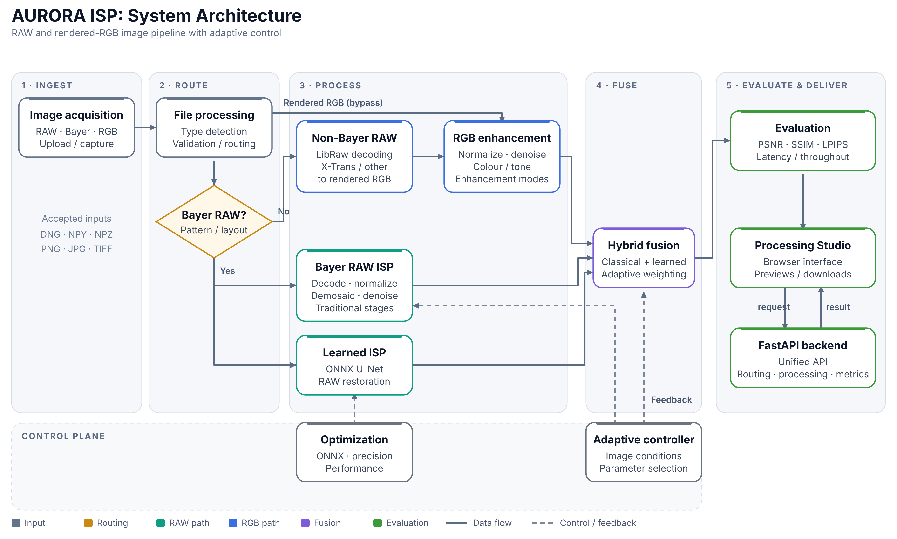

# AURORA ISP

**Adaptive Unified RAW Optimization and Reconstruction Architecture**

A modular, hybrid image signal processor that turns Bayer sensor data into display-ready RGB by combining a classical ISP, a learned RAW-to-sRGB U-Net and an adaptive fusion policy. It ships with a local browser-based Processing Studio, ONNX model variants and an evaluation framework that reports image quality and runtime together.

Built for the Computer Vision Hackathon 2026, problem P2: *Intelligent and Computationally Efficient Smartphone ISP*.



---

## Table of contents

1. [Why AURORA](#why-aurora)
2. [Features](#features)
3. [Architecture](#architecture)
4. [Quick start](#quick-start)
5. [Using the Processing Studio](#using-the-processing-studio)
6. [Python API](#python-api)
7. [Supported inputs](#supported-inputs)
8. [Training](#training)
9. [Evaluation and results](#results)
10. [Model optimization](#model-optimization)
11. [Repository structure](#repository-structure)
12. [Testing](#testing)
13. [Limitations](#limitations)
14. [Roadmap](#roadmap)
15. [Documentation](#documentation)

---

## Why AURORA

A phone camera sensor does not capture a finished RGB photo. It records a mosaic of single-colour measurements through a colour filter array (usually Bayer). An ISP must turn that into a photograph: black-level correction, normalization, demosaicing, white balance, colour correction, denoising, tone mapping, gamma encoding and sharpening.

A fixed pipeline struggles when conditions change. Low light, high ISO, clipped highlights, mixed lighting and fine texture each call for different decisions. AURORA's research question is:

> Can a hybrid ISP combine the efficiency and interpretability of classical processing with the reconstruction ability of neural networks, adapt to capture conditions, and stay practical for resource-constrained devices?

## Features

- **Three selectable ISP modes**
  - **Traditional ISP:** deterministic RAW preprocessing, demosaicing, white balance, CCM, classical denoising and photofinishing.
  - **Learned ISP:** metadata-conditioned U-Net that predicts camera-rendered sRGB from packed 4-channel Bayer RAW.
  - **Hybrid ISP:** classical front-end plus learned restoration, fused by an image-condition-aware policy.
- **Separate rendered-RGB pipeline** for PNG/JPEG inputs (denoise, detail-preserving denoise, full enhancement). Ordinary images never pass through Bayer demosaicing.
- **Adaptive controller** that analyses noise, luminance, clipping, shadows, edge density and colour cast.
- **Processing Studio:** local FastAPI backend and browser UI with an interactive architecture diagram.
- **Evaluation:** PSNR, SSIM, Delta E 2000 and LPIPS against an optional clean reference, plus latency, throughput, CPU, RAM and GPU/VRAM status.
- **Deployment experiments:** ONNX export with FP32, FP16 and INT8 variants.
- **Training workflow** for SIDD-CC with capture-aware batching, checkpointing and optional mixed precision.

## Architecture

```
Image input
    |
File detection and validation
    |
    +--------------------+----------------------+
    |                    |                      |
Bayer RAW          Non-Bayer RAW          Rendered RGB
    |             (LibRaw -> RGB)          (PNG / JPEG)
    |                    |                      |
    |                    +----------+-----------+
    |                               |
    |                       RGB enhancement
    |                               |
+---+-----------+                   |
|               |                   |
Traditional   Learned ISP           |
ISP           (ONNX U-Net)          |
|               |                   |
+-------+-------+                   |
        |                           |
        +-------------+-------------+
                      |
               Hybrid fusion  <--- Adaptive controller
                      |
                Evaluation and metrics
                      |
        Processing Studio / FastAPI response
```

The diagram groups the pipeline into five stages: **Ingest, Route, Process, Fuse, Evaluate and Deliver**, with a control plane (Adaptive controller, Optimization) feeding the processing stages.

The flow above is conceptual. The RAW and RGB branches are separate, and not every input reaches RAW fusion.

### Stack

| Layer | Technology |
| --- | --- |
| Core processing | Python, NumPy, SciPy, OpenCV, scikit-image, Pillow |
| RAW decoding | rawpy / LibRaw |
| Learned model | PyTorch (training), ONNX Runtime (deployment experiments) |
| Backend | FastAPI, Uvicorn, python-multipart, psutil |
| Frontend | HTML, CSS, JavaScript (no build step) |
| Tests | pytest |

## Quick start

**Requirements:** Python 3.10 or newer. Windows scripts are provided. Other platforms can run the same commands manually.

```powershell
# 1. Create an isolated environment
py -3 -m venv .venv
.venv\Scripts\activate

# 2. Install PyTorch from the official selector for your CPU/CUDA setup
#    https://pytorch.org/get-started/locally/

# 3. Install the app dependencies
python -m pip install -r requirements-app.txt

# 4. Start the Studio
python -m uvicorn app.main:app --host 127.0.0.1 --port 8000
```

Then open **http://127.0.0.1:8000**.

Shortcuts: `run_aurora.bat` creates the `.venv`, installs `requirements.txt` and starts the server. `run_studio.bat` / `run_studio.ps1` start the server in an existing environment.

Optional extras: `requirements-restoration.txt` (BM3D and wavelet experiments), `requirements-train.txt` (training).

## Using the Processing Studio

1. Choose an input image (DNG, NPY, NPZ, PNG, JPG).
2. For Bayer RAW, leave the pattern on **Auto** or set RGGB / BGGR / GRBG / GBRG.
3. Optionally add a **reference image** for metrics. The reference is used for evaluation only and never enters the processing pipeline. Dimensions must match the rendered output.
4. Select processing modes (Traditional, Neural restoration, Hybrid) and click **Process image**.
5. Compare variants, inspect image-condition analysis and read the metrics and performance panels. Download results as PNG.

Click any block in the architecture diagram to see its role and connections. Use the **RAW path**, **RGB path** and **Output path** filters to trace a route.

### API

| Endpoint | Purpose |
| --- | --- |
| `GET /` | Serves the Studio interface |
| `GET /api/health` | Backend and model status |
| `POST /api/process` | Accepts an image plus configuration, returns JSON and image output |

The Studio runs locally. Images stay on the machine and the browser is only the interface, not the inference engine.

## Python API

```python
from core.pipeline import traditional_isp, learned_isp, hybrid_isp
from models.learned_isp.unet import AuroraUNet
from models.learned_isp.adapter import LearnedISP

meta = {"pattern": "RGGB", "black_level": 0, "white_level": 1,
        "iso": 800, "exposure_ms": 8.0, "analog_gain": 2.0}

traditional = traditional_isp(bayer_mosaic, meta)   # sRGB HxWx3 float32 in [0, 1]

model = AuroraUNet(base=24, meta_dim=5)
# Load trained weights (for example models/checkpoints/aurora_v4_best.pt) first.
adapter = LearnedISP(model)

learned = learned_isp(bayer_mosaic, meta, adapter)
hybrid, conditions, decisions = hybrid_isp(bayer_mosaic, meta, adapter)
```

Input must be a finite, even-sized, single-channel Bayer mosaic (at least 4x4) with an explicit Bayer pattern and correct black and white levels.

> **Important:** the learned model predicts **camera-rendered sRGB** directly. Do not apply gamma or tone mapping to its output a second time.

## Supported inputs

| Input | Path | Status |
| --- | --- | --- |
| DNG (Bayer) | RAW ISP via `rawpy` | Supported |
| NPY Bayer mosaic | RAW ISP | Supported |
| NPZ Bayer mosaic with metadata | RAW ISP | Supported |
| PNG / JPG / JPEG | RGB enhancement | Supported |
| Other camera RAW (CR3, NEF, ARW, RAF, RW2, ORF, X-Trans) | LibRaw render, then RGB enhancement | Best effort. Validate per camera before relying on it |

Non-Bayer RAW is rendered to RGB by LibRaw and handled by the RGB branch. It does **not** run the Bayer-trained model.

### RGB modes

| Mode | Processing |
| --- | --- |
| RGB Original | Pass-through baseline |
| RGB Denoise | OpenCV coloured Non-Local Means |
| RGB Detail-Preserving Denoise | Medium denoising with restrained sharpening |
| RGB Full Enhancement | Denoise, gray-world white balance, adaptive exposure, LAB + CLAHE, saturation, sharpening |

## Training

The learned ISP is trained on paired **SIDD-CC** Bayer mosaics and camera-rendered sRGB targets:

`f(Bayer RAW, metadata) -> camera-rendered sRGB`

```powershell
python -m experiments.training.train `
  --data-root "PATH_TO_SIDD_CC" `
  --epochs 30 `
  --patch-size 128 `
  --batch-size 2 `
  --patches-per-capture 8 `
  --workers 0 `
  --amp
```

Features: patch-based training, capture-aware batching, per-epoch capture shuffling, five-value metadata conditioning, best and latest checkpoints, resume with `--resume`, and automatic CUDA with optional AMP (CPU fallback is slower). Decoded data is cached one capture at a time to keep RAM use low.

Checkpoints are written to `models/checkpoints/aurora_v4_best.pt` and `aurora_v4_best_latest.pt`. Validation values printed during training are patch-level monitoring numbers, not a final benchmark.

Verify dataset layout, Bayer representation, pairing, licence and colour-space semantics before training. See `docs/DATASET_CONTRACT.md`.

## Results

Held-out evaluation on **24 SIDD-CC captures** (instance-level validation split, seed 42, 1024 px crops, camera-rendered clean sRGB as reference). Measured on an NVIDIA RTX 4060 Laptop GPU with PyTorch 2.9.1 (CUDA). Source: `eval_full/summary.json`.

| Mode | PSNR (dB) ↑ | SSIM ↑ | Delta E 2000 ↓ | LPIPS ↓ | Median latency (ms) |
| --- | ---: | ---: | ---: | ---: | ---: |
| Traditional | 21.79 | 0.801 | 13.38 | 0.366 | 572 |
| Hybrid (classical only) | 21.55 | 0.763 | 13.67 | 0.420 | 662 |
| Learned (neutral conditioning) | 23.65 | 0.814 | 10.74 | 0.350 | 274 |
| Learned (estimated conditioning) | 23.48 | 0.820 | 11.00 | 0.350 | 269 |
| Hybrid (learned, estimated) | 22.67 | 0.821 | 12.11 | 0.344 | 788 |

The "oracle" learned row (23.61 dB) uses ground-truth information and is not deployable, so it is left out of the comparison above.

How to read this honestly:

- The learned model beats the traditional baseline on all four quality metrics and runs about twice as fast in this setup.
- The current **hybrid policy does not beat the learned branch** on PSNR and Delta E. Its SSIM and LPIPS are marginally better. The fusion weights are heuristic, not trained.
- This is a 24-capture split on one dataset and one GPU. It does not establish generalization across cameras, nor a comparison with commercial ISPs.
- Synthetic smoke benchmarks (`experiments/benchmarks/compare_modes.py`) only verify that code runs. They say nothing about image quality.

### Metrics

| Metric | Measures | Better |
| --- | --- | --- |
| PSNR | Pixel-level reconstruction error | Higher |
| SSIM | Structural similarity | Higher |
| Delta E 2000 | Perceptual colour difference (CIELAB) | Lower |
| LPIPS | Learned perceptual similarity (needs optional dependency and weights) | Lower |

If LPIPS is unavailable, the Studio reports it as unavailable instead of inventing a value. Metrics need a matching clean reference and are never estimated without one. The Studio also reports processing time, throughput (MP/s), CPU, RAM, GPU status and VRAM, all measured on the local backend process.

## Model optimization

ONNX models are provided in `hybrid_models/`:

| Model | FP32 | FP16 | INT8 |
| --- | :---: | :---: | :---: |
| Learned ISP | ✓ | ✓ | ✓ |
| Hybrid | ✓ | ✓ | ✓ |

Export and quantization: `models/quantized/export_and_quantize.py`.

The existence of FP16 and INT8 files does not by itself show they are faster or equally accurate. A controlled precision-versus-quality benchmark is still needed. The Studio currently runs ONNX inference on CPU: in the tested environment ONNX Runtime exposed only `AzureExecutionProvider` and `CPUExecutionProvider`. CUDA inference through the Studio is not yet verified, although training does use CUDA.

## Repository structure

```
AURORA-ISP/
├── app/                    FastAPI backend and Studio UI (static/index.html)
├── core/                   ISP stages: raw, preprocessing, demosaicing, colour,
│                           denoising, photofinishing, adaptive_controller, evaluation
├── isp/                    ISP engine, classical stages, IO, metrics, camera calibration
├── models/                 learned_isp (U-Net, adapter), hybrid_isp, checkpoints, quantized
├── hybrid_models/          ONNX FP32 / FP16 / INT8 exports
├── datasets/               Dataset loader
├── experiments/
│   ├── training/           train.py
│   └── benchmarks/         compare_modes, evaluate_real, evaluate_robustness, restore_rgb_sweep
├── eval_full/  eval_smoke/ Per-capture CSVs and summary JSON
├── docs/                   Architecture, design, limitations, dataset contract, release notes
├── tests/                  pytest suite
├── frontend/               Standalone frontend variant
└── requirements*.txt, run_aurora.bat, run_studio.bat, run_studio.ps1
```

The repository contains both `core/` and `isp/` implementations. See `docs/SOURCE_OF_TRUTH.md` for which engine each processing path calls.

## Testing

```powershell
python -m pytest -q
python -m experiments.benchmarks.compare_modes --size 256
```

Tests cover core ISP behaviour, dataset and DNG loading, hybrid policy, RGB uploads, robustness and processing contracts. Passing tests show correct shapes, validation and API integration. They do not prove image-quality superiority across devices.

## Limitations

| Area | State |
| --- | --- |
| Hybrid fusion | Heuristic policy, not shown to be optimal |
| Cross-camera generalization | Not demonstrated; needs held-out camera experiments |
| Other camera RAW formats | Must be validated per format and camera |
| Sensor calibration | Simplified black-level handling; no full per-channel maps, lens shading or per-camera colour matrices |
| Noise estimation | Image statistics, not calibrated per sensor |
| Clipped highlights | Information lost to clipping cannot be recovered from a single RAW |
| CUDA inference in Studio | Not verified (CPU provider observed) |
| FP16 / INT8 | Artifacts exist; comparative benchmarks pending |
| Mobile (Android, iOS, NNAPI, Core ML) | Not implemented or validated; this is a PC-hosted Python app |
| Reference-assisted tuning | RGB parameter sweeps that select on the reference are not blind performance |

More detail: `docs/limitations.md`.

## Roadmap

1. **Validation:** reproducible RAW-to-RGB protocol; Traditional vs Learned vs Hybrid on the same held-out captures across ISO, illumination and cameras.
2. **GPU inference:** CUDA-enabled ONNX Runtime, then profile latency, utilization and VRAM against CPU.
3. **Hybrid policy:** evaluate on a full held-out split; try learned or optimization-based fusion weights; show whether hybrid beats its best branch.
4. **Optimization:** benchmark FP32/FP16/INT8 for size, latency, memory and quality; consider pruning or distillation.
5. **Mobile:** export to mobile formats and measure on real devices.

## Documentation

| Document | Contents |
| --- | --- |
| `docs/architecture.md` | Processing architecture |
| `docs/design_document.md` | Design rationale |
| `docs/IMPLEMENTATION_STATUS_V6.md` | Implemented features and verification |
| `docs/PROCESSING_STUDIO.md` | Studio behaviour and input rules |
| `docs/MODULAR_ISP_V5.md` | Intermediate stages and RGB restoration |
| `docs/DATASET_CONTRACT.md` | Training data requirements |
| `docs/limitations.md` | Known gaps |

## Acknowledgements

Training uses the SIDD / SIDD-CC datasets. Check the dataset licence before redistributing data or derived weights. Built on PyTorch, ONNX Runtime, OpenCV, rawpy/LibRaw, scikit-image and FastAPI.

Repository: <https://github.com/Thejas2005/AURORA-ISP>
