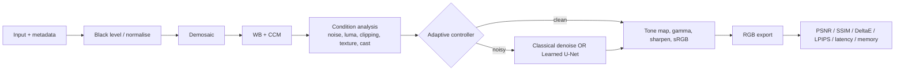

# AURORA ISP architecture (diagram for submission)

Modes: **Traditional** = fixed classical path (`core/pipeline.py:traditional_isp`); **Learned** = `models/learned_isp`;
**Hybrid** = classical front end + controller + learned restore (`hybrid_isp`). Status of each: see README.
